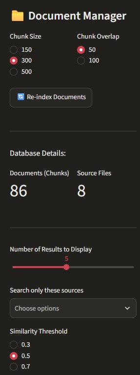
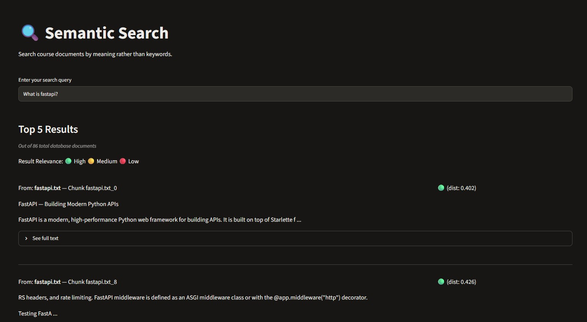
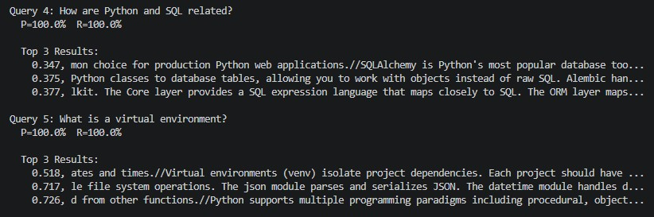
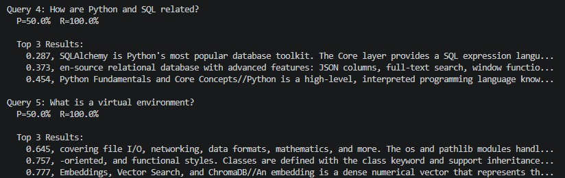

# Semantic Search Tool

This project pertains to a semantic search tool. The tool loads, chunks, embeds, and stores documents in a ChromaDB database. Users can then query the database via a Streamlit interface.

## Core Technologies
- Streamlit
- ChromaDB
- SentenceTransformer

## Features
- Re-indexing button
- Search input with ranked results, including distance indicator
- Configurable chunk size, overlap, n_results display, as well as filters for similarity threshold and source file(s)
- Chunking experiment (`evaluate.py`)

## File Structure
```text
chroma_data/         — ChromaDB storage folder; created once documents are indexed
│
docs/                — Contains source files to be loaded, chunked, embedded, and stored in the database
│
screenshots/         — Project screenshots
│
.gitignore           — Designates which files to exclude from GitHub
app.py               — Main file; renders the Streamlit interface
evaluate.py          — Chunking experiment pipeline; separate from the main search tool
ingest.py            — Sidebar display and functions for loading, chunking, embedding, and storing documents
README.md            — Project documentation *(this document)*
requirements.txt     — Packages and dependencies
search.py            — Search interface, result display, and query embedding
```

## Screenshots

### Sidebar


### Search Interface with Results



## Chunking Experiment

Documents were indexed at two different chunk sizes: 150 and 300. The same 5 test queries were applied to each collection so as to compare the top 3 retrieved results, distance scores, relevance, precision, and recall.

### Evaluation at Chunk Size 150


### Evaluation at Chunk Size 300


### Results
With the smaller chunk size of 150, all 5 queries returned 100% for both precision and recall. In contrast, at the larger chunk size of 300, queries 3-5 returned only 50% precision. Hence, it seems precision was lost due to the additional context introduced at the larger chunk size, whereas smaller chunks enable the system to target more specific passages, the latter thereby resulting in greater precision scores for this set of source files and queries.

The first two queries performed the best across both tests (100% for both precision and recall), suggesting that the queries may be more specific and directly related to the source files. In this sense, future tests could include adjusting queries 3-5 to be more specific to the source files in order to assess whether this impacts the precision and recall scores.

Overall, I found the results to be only marginally relevant, despite some similarity scores under 0.3. For example, the query pertaining to FastAPI requests did not include either of the passages regarding Pydantic models, and the query pertaining to Streamlit remembering data between interactions entirely overlooked the passage regarding st.session_state. This suggests that the issue may stem from the underlying AI model used and how it was trained or programmed to assess similarity. Another possible consideration for the poor relevance might be the embedding model used for this experiment. As a result, future tests could include utilizing ChromaDB's embedding for both documents and queries and assessing whether this improves relevance.


### Setup
1. Clone this repo
2. Create a virtual environment (e.g. for Windows/Git Bash: `python -m venv venv`)
3. Activate the virtual environment (e.g. for Windows/Git Bash: `source venv/Scripts/activate`)
4. Install dependencies (e.g. for Windows/Git Bash: `pip install -r requirements.txt`)
5. To run the Streamlit interface, run: `streamlit run app.py`
6. To run the chunking experiment, run: `python evaluate.py`